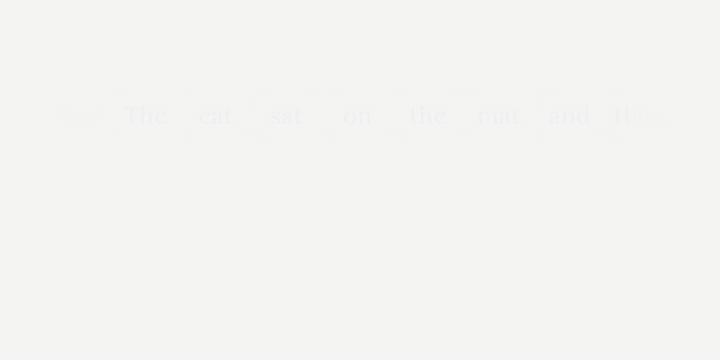

# Reconsidering Positional Supervision in Masked Diffusion Language Model Training

[](https://arxiv.org/abs/2601.22947)
[](https://muyo8692.com/projects/mdlm-slack/)
[](https://huggingface.co/collections/muyo/positional-supervision-in-mdlm-training-neurips-2026-6ae864cd1b67339c37e4fdd3)

Code for our NeurIPS 2026 paper, by Mengyu Ye, Keito Kudo, Ryosuke Takahashi, and Jun Suzuki.

<p align="center"><a href="https://muyo8692.com/projects/mdlm-slack/"></a></p>

Masked diffusion LMs are trained with position-wise cross-entropy, so once the output slips by one slot, every later position is penalized. We show that LLaDA-8B-Instruct is sensitive to such shifts at decoding time, and add a CTC-style auxiliary loss (CTC-S) with a `<SLACK>` token that absorbs them during SFT.

## Setup

```bash
uv sync
cp config.example.yaml config.yaml   # model / dataset ids, output dirs
cp .env.example .env                 # HF_TOKEN
```

## Data

```bash
# slack-primed (Jitter, CE + CTC-S)
uv run python scripts/preprocess_magpie.py --min-tokens 512 --max-tokens 1024 --max-seq-length 2048 --push-to-hub

# raw (CE-Only)
uv run python scripts/preprocess_magpie.py --noslack-priming --min-tokens 512 --max-tokens 1024 --max-seq-length 2048 --push-to-hub
```

Both are Magpie-Pro-300K-Filtered restricted to responses of 512–1024 tokens. `<SLACK>` tokens are inserted by the training collator, not stored in the dataset.

The splits used in the paper are on the Hub and are the defaults in `config.example.yaml`, so preprocessing is only needed to rebuild them: [`muyo/Magpie-Pro-300K-Filtered-512-1024`](https://huggingface.co/datasets/muyo/Magpie-Pro-300K-Filtered-512-1024) (raw), [`muyo/Magpie-Pro-300K-Filtered-CTC-512-1024`](https://huggingface.co/datasets/muyo/Magpie-Pro-300K-Filtered-CTC-512-1024) (slack-primed, LLaDA), [`muyo/Magpie-Pro-300K-Filtered-CTC-512-1024-MoE`](https://huggingface.co/datasets/muyo/Magpie-Pro-300K-Filtered-CTC-512-1024-MoE) (slack-primed, LLaDA-MoE).

## Training

```bash
uv run python scripts/sft_train.py        --job_name llada-ce-only   # CE-Only
uv run python scripts/sft_train_jitter.py --job_name llada-jitter    # Jitter
uv run python scripts/sft_train_ctc.py    --job_name llada-ce-ctcs   # CE + CTC-S
```

Jitter is the CE + CTC-S trainer with `ctc_weight=0`. Hyperparameters follow Appendix B.2; `--slack_max_ratio` (default 0.5) reproduces the ablation in Sec. 6.4. For LLaDA-MoE (Appendix D) use the `_moe` scripts.

## Checkpoints

The models from the paper are in [this collection](https://huggingface.co/collections/muyo/positional-supervision-in-mdlm-training-neurips-2026-6ae864cd1b67339c37e4fdd3). They are full models with the LoRA adapters merged in and load like the base model.

| Paper | LLaDA-8B-Instruct | LLaDA-MoE-7B-A1B-Instruct |
|---|---|---|
| CE-Only | [`muyo/LLaDA-8B-Instruct-CE-Only`](https://huggingface.co/muyo/LLaDA-8B-Instruct-CE-Only) | [`muyo/LLaDA-MoE-7B-A1B-Instruct-CE-Only`](https://huggingface.co/muyo/LLaDA-MoE-7B-A1B-Instruct-CE-Only) |
| Jitter | [`muyo/LLaDA-8B-Instruct-Jitter`](https://huggingface.co/muyo/LLaDA-8B-Instruct-Jitter) | [`muyo/LLaDA-MoE-7B-A1B-Instruct-Jitter`](https://huggingface.co/muyo/LLaDA-MoE-7B-A1B-Instruct-Jitter) |
| CE + CTC-S | [`muyo/LLaDA-8B-Instruct-CE-CTC-S`](https://huggingface.co/muyo/LLaDA-8B-Instruct-CE-CTC-S) | [`muyo/LLaDA-MoE-7B-A1B-Instruct-CE-CTC-S`](https://huggingface.co/muyo/LLaDA-MoE-7B-A1B-Instruct-CE-CTC-S) |
| CE + CTC-S, s_max = 0.2 / 0.8 (Sec. 6.4) | [`…-CE-CTC-S-smax0.2`](https://huggingface.co/muyo/LLaDA-8B-Instruct-CE-CTC-S-smax0.2) / [`…-smax0.8`](https://huggingface.co/muyo/LLaDA-8B-Instruct-CE-CTC-S-smax0.8) | – |

Jitter and CE + CTC-S expect the slack-priming system prompt used in training (see `scripts/preprocess_magpie.py`) and emit `<SLACK>` (`<|reserved_token_0|>`, id 126084; MoE: `<|reserved_token_6|>`, id 156901), which is stripped from the output.

## Generation

```bash
uv run python scripts/run_generate.py --variant llada --model-path /path/to/ckpt \
    --prompt "Explain inertia like I'm five." \
    --steps 512 --gen-length 1024 --block-length 1024 --no-suppress-eos
```

Shift intervention (Sec. 3.3): at each listed t, swap `--insert-n` revealed tokens with an adjacent mask.

```bash
uv run python scripts/run_generate.py --variant llada --prompt "..." --preliminary-exp \
    --insert-n 2 --insert-fractions "[0.5,0.55,0.6,0.65,0.7,0.75,0.8,0.85,0.9,0.95]" \
    --steps 512 --gen-length 1024 --block-length 1024 --no-suppress-eos
```

With these 10 thresholds, `--insert-n 1/2/4/6` gives the 1/2/4/6% settings in Figures 1 and 2. `--block-length` smaller than `--gen-length` gives the block-diffusion sweep in Appendix E.

Evaluation harnesses (Arena-Hard-Auto, MT-Bench, WildBench, Creative-Writing-Bench, OpenCompass) are external; see Table 9.

## Citation

```bibtex
@inproceedings{ye2026reconsidering,
  title     = {Reconsidering Positional Supervision in Masked Diffusion Language Model Training},
  author    = {Ye, Mengyu and Kudo, Keito and Takahashi, Ryosuke and Suzuki, Jun},
  booktitle = {40th Conference on Neural Information Processing Systems (NeurIPS 2026)},
  year      = {2026}
}
```

## License

MIT.
